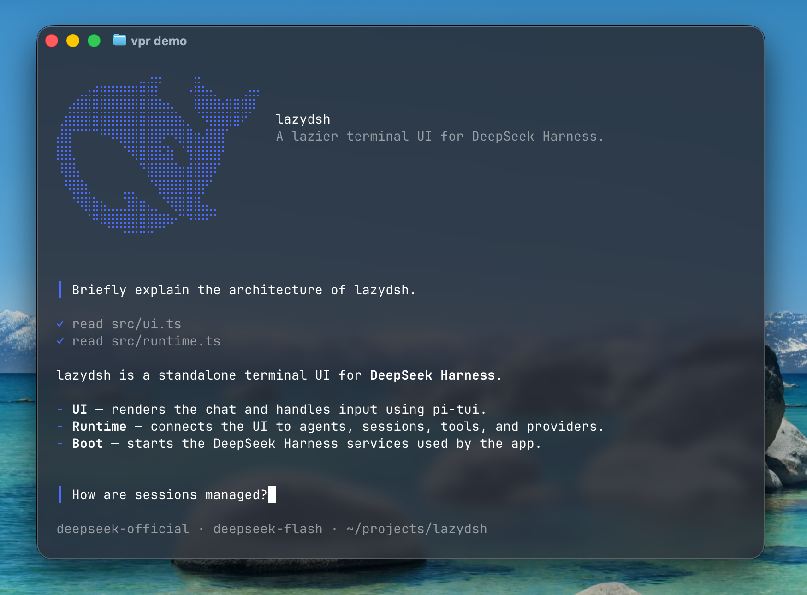

# lazydsh

[](https://github.com/nuskey8/lazydsh/avctions/workflows/ci.yml)
[](https://github.com/nuskey8/lazydsh/releases/latest)
[](https://www.npmjs.com/package/lazydsh)

English | [简体中文](README.zh-CN.md) | [日本語](README.ja.md)

A lazier terminal UI for DeepSeek Harness.



## Overview

lazydsh is a TUI harness powered by [DeepSeek Harness](https://deepseek.com/en/harness/) as its backend. It contains only the essential features required to handle DeepSeek Harness in a TUI, making it lightweight compared to other DSH TUI clients such as [dsh-TUI](https://dshtui.com/en).

## Features

### Lightweight & Fast

lazydsh is built on top of [pi](https://pi.dev/) and [pi-tui](https://github.com/earendil-works/pi-tui). It provides a simple, user-friendly, and high-performance TUI with only the necessary features.

- **Cold start < 500ms** — deferred plugin loading activates 50+ tool plugins after first paint
- **60fps idle / 30fps streaming** — optimized render loop with incremental syntax highlighting
- **< 100MB memory** — minimal footprint with efficient event sourcing

### Standalone

lazydsh is **NOT** a DSH plugin.

Many DSH TUI clients are provided as plugins, which can lead to version compatibility issues with the core DSH installation.

lazydsh is an independent CLI tool containing only the core parts of DSH. It can run on Node without requiring the full DSH main package.

### Provider Independent

lazydsh supports all providers natively supported by pi out-of-the-box. You can connect and use subscriptions from OpenAI, Anthropic, Google, OpenCode, and others, in addition to DeepSeek.

### pi-coding-agent Parity

lazydsh implements the full interactive experience of pi-coding-agent:

| Feature               | Status                                                                |
| --------------------- | --------------------------------------------------------------------- |
| **Layout**            | ✅ Header / Transcript / Pending / Status / Widgets / Editor / Footer |
| **Footer**            | ✅ Tokens, cost, context%, model, git, extensions, responsive         |
| **Tool Cards**        | ✅ Live streaming, diffs, expandable, images, duration                |
| **Bash Execution**    | ✅ ANSI strip, exit code pill, truncation warning                     |
| **Model Selector**    | ✅ Fuzzy search, async refresh, save default, scoped/all              |
| **Session Selector**  | ✅ Tree view, fuzzy search, archive/rename, progress                  |
| **Keybindings**       | ✅ Configurable, hot-reload, legacy migration                         |
| **Theme System**      | ✅ Tokens, DA1 sync, live reload, auto light/dark                     |
| **Messages**          | ✅ Thinking toggle, OSC133 zones, stop reasons                        |
| **Status**            | ✅ Working / Retry / Compaction / Idle indicators                     |
| **Header**            | ✅ Logo, key hints, click expand, changelog                           |
| **External Editor**   | ✅ Ctrl+G opens $EDITOR                                               |
| **Copy Message**      | ✅ Ctrl+X copies last assistant message                               |
| **Thinking Selector** | ✅ Ctrl+T cycles reasoning effort                                     |
| **Bug Report**        | ✅ /bug with auto-attached crash details                              |
| **Program Status**    | ✅ OSC 7501 (idle/working/blocked/done/error)                         |
| **Session Share**     | ✅ /share generates share link                                        |
| **Changelog**         | ✅ /changelog with expand/collapse                                    |
| **Settings**          | ✅ /settings (5 categories)                                           |
| **Widgets**           | ✅ Extension widget registry (above/below editor)                     |

## Installation

Node.js 24.9.0 or higher is required.

```sh
npm install -g lazydsh
```

## Usage

```sh
lazydsh — A lazier terminal UI for DeepSeek Harness.

Usage:
  lazydsh [flags]
  lazydsh <command> [arguments] [flags]
  echo "prompt" | lazydsh ask [flags]

Commands:
  ask [prompt]            Run one noninteractive request
  resume [session-id]     Continue a saved conversation
  login [provider]        Log in with OAuth or an API key
  logout [provider]       Remove saved provider credentials
  upgrade                 Update lazydsh to the latest version

Flags:
  --provider <id>         Provider (default: last used, then deepseek-official)
  --model <id>            Model (default: last used or provider default)
  --effort <level>        Initial reasoning effort
  --permission <preset>   Permission preset for ask (default: dsh policy)
  --cwd <path>            Working directory (default: current directory)
  --home <path>           DSH home directory
  --resume <id>           Continue a saved conversation
  --patch <path>          Additional dsh Cordis patch (repeatable)
  --list                  List providers and model IDs
  -h, --help              Show help

```

## TUI Keybindings

All keybindings are configurable in `~/.config/lazydsh/keybindings.json`. The file is created on first run with defaults.

### Global

| Action             | Default          | Description                                     |
| ------------------ | ---------------- | ----------------------------------------------- |
| Interrupt / Cancel | `Escape`         | Cancel running turn, close dialogs              |
| Clear Editor       | `Ctrl+C`         | Clear editor when empty; stop turn when running |
| Exit               | `Ctrl+D`         | Exit when editor is empty                       |
| Suspend            | `Ctrl+Z`         | Suspend to background (Unix)                    |
| Delete Session     | `Ctrl+Backspace` | Archive a session (empty editor)                |
| External Editor    | `Ctrl+G`         | Open `$EDITOR` with current text                |
| Copy Message       | `Ctrl+X`         | Copy last assistant message or selection        |
| Toggle Thinking    | `Ctrl+T`         | Cycle reasoning effort level                    |
| Queue Follow-up    | `Alt+Enter`      | Queue a follow-up message                       |
| Restore Queued     | `Alt+Up`         | Restore queued messages                         |
| Paste Image        | `Ctrl+V`         | Paste image/text from clipboard                 |

### Model & Session

| Action               | Default        | Description                   |
| -------------------- | -------------- | ----------------------------- |
| Model Selector       | `Ctrl+L`       | Open model selector           |
| Cycle Model Forward  | `Ctrl+P`       | Next model                    |
| Cycle Model Backward | `Shift+Ctrl+P` | Previous model                |
| Session Toggle Named | `Ctrl+N`       | Toggle named session filter   |
| Save Model Default   | `Ctrl+S`       | Save current model as default |

### Tool & UI

| Action         | Default     | Description                           |
| -------------- | ----------- | ------------------------------------- |
| Expand Tool    | `Ctrl+O`    | Toggle tool output expanded/collapsed |
| Cycle Thinking | `Shift+Tab` | Cycle reasoning effort                |

### Session Selector (when open)

| Action       | Default  | Description                   |
| ------------ | -------- | ----------------------------- |
| Navigate     | `↑/↓`    | Move selection                |
| Select       | `Enter`  | Resume selected session       |
| Cancel       | `Escape` | Close selector                |
| Delete       | `Ctrl+D` | Archive session               |
| Rename       | `Ctrl+R` | Rename session                |
| Toggle Scope | `Tab`    | Current folder / All folders  |
| Toggle Sort  | `Ctrl+S` | Threaded / Recent / Relevance |
| Toggle Named | `Ctrl+N` | All / Named only              |
| Toggle Path  | `Ctrl+P` | Show/hide paths               |

### Model Selector (when open)

| Action       | Default  | Description           |
| ------------ | -------- | --------------------- |
| Navigate     | `↑/↓`    | Move selection        |
| Select       | `Enter`  | Use selected model    |
| Cancel       | `Escape` | Close selector        |
| Save Default | `Ctrl+S` | Save as default model |
| Toggle Scope | `Tab`    | Scoped / All models   |

### Commands (in editor)

| Command                                         | Description                                   |
| ----------------------------------------------- | --------------------------------------------- |
| `/clear`                                        | Clear screen while keeping session            |
| `/resume`                                       | Select and resume a session                   |
| `/cd`                                           | Choose working directory                      |
| `/permission [preset]`                          | View/select permission presets                |
| `/model`                                        | Select provider and model                     |
| `/login [provider]`                             | Log in with OAuth or API key                  |
| `/logout [provider]`                            | Remove saved credentials                      |
| `/file <path> \| clear`                         | Attach file/image or clear attachments        |
| `/dsh <cmd> [args]`                             | Run native DSH commands                       |
| `/effort [level\|default]`                      | Select reasoning effort                       |
| `/new`                                          | Start new conversation                        |
| `/rename [title]`                               | Rename current session                        |
| `/fork`                                         | Fork session from completed turn              |
| `/archive`                                      | Archive a session                             |
| `/restore`                                      | Restore archived session                      |
| `/pin`                                          | Pin a session                                 |
| `/unpin`                                        | Unpin a session                               |
| `/ps`                                           | Check background jobs                         |
| `/stop`                                         | Stop a background job                         |
| `/session`                                      | Show current session ID                       |
| `/status`                                       | Display model, session, usage, limits, config |
| `/compact`                                      | Summarize session history                     |
| `/plan [off\|message]`                          | Start/end plan mode                           |
| `/goal [objective\|clear\|edit\|pause\|resume]` | Manage goals                                  |
| `/feedback <text>`                              | Record feedback                               |
| `/export [path.zip]`                            | Export sessions to ZIP                        |
| `/bug`                                          | Report a bug with crash details               |
| `/share`                                        | Generate session share link                   |
| `/changelog`                                    | Show version history                          |
| `/settings`                                     | Open settings UI                              |
| `/quit`                                         | Exit lazydsh                                  |

Custom DSH plugin commands are also available.

## Theme System

Themes use semantic tokens and live-reload on file change. The default theme is at `~/.config/lazydsh/theme.json`.

### Token Categories

```json
{
  "colors": { "accent": "#00d9ff", "warning": "#ffcc00", "error": "#ff5555", ... },
  "semantic": {
    "status.working": "accent",
    "status.idle": "green",
    "status.error": "error",
    "footer.tokens": "muted",
    "footer.cost": "green",
    ...
  },
  "ui": {
    "header.logo": "accent",
    "header.version": "muted",
    "tool.pending.border": "accent",
    "tool.running.border": "blue",
    "tool.success.border": "green",
    "tool.error.border": "error",
    ...
  }
}
```

### Theme Commands

- `/settings` → Appearance → Theme — full picker with live preview (all built-in and user themes); selecting saves, cancelling restores
- Edit `~/.config/lazydsh/theme.json` — changes apply instantly
- **auto (follow terminal)** — pick a light theme and a dark theme; the controller switches between them on every terminal light/dark change (DA1)
- System theme follows terminal (DA1 query) — auto light/dark

### DA1 Terminal Color Sync

On startup, lazydsh queries the terminal's ANSI palette (DA1) and generates a system theme that matches your terminal's colors. This works automatically — no config needed.

## Tool Cards

Tool executions render as rich cards with:

- **Live streaming** — args and results update in real-time
- **Custom renderers** — bash, file ops, search, web search, task, etc.
- **Diff rendering** — word-level intra-line diffs for file edits
- **Expandable** — click to expand/collapse (or `Ctrl+O`)
- **Images** — base64 images display inline
- **Duration** — shows execution time on completion
- **Color coding** — pending (blue), running (blue), success (green), error (red)

### Bash Execution

Specialized terminal card for shell commands:

- Streaming stdout/stderr with ANSI stripping
- Preview (last 20 lines) / expanded (all lines) modes
- Exit code pill: 🟢 0 | 🔴 non-zero | 🟡 cancelled
- Truncation warning with full output path
- `!!` prefix excludes command from context

## Model Selector (`/model` or `Ctrl+L`)

- **Fuzzy search** — type to filter providers/models
- **Scoped / All** — `Tab` toggles between current provider's models and all
- **Current marker** — ✓ shows active model
- **Default badge** — "· default" for provider default
- **Save default** — `Ctrl+S` persists to preferences
- **Catalog** — every model in the bundled table in one fuzzy list (no network fetch); `scoped` limits to providers you can authenticate against
- **Error handling** — shows provider failures inline

## Session Selector (`/resume`)

- **Tree view** — threaded sessions with branch characters (├─ └─ │)
- **Fuzzy search** — regex (`re:pattern`), exact (`"text"`), or plain
- **Scope toggle** — `Tab`: Current Folder / All
- **Sort toggle** — `Ctrl+S`: Threaded / Recent / Relevance
- **Name filter** — `Ctrl+N`: All / Named only
- **Path display** — `Ctrl+P`: show/hide working directories
- **Archive** — `Ctrl+D` archives session (DSH-native)
- **Rename** — `Ctrl+R` inline editor
- **Progress** — shows loaded/total during fetch
- **Markers** — accent ✓ for current, ★ for pinned

## Status Indicators

The status area (above editor) shows:

| State          | Indicator                           |
| -------------- | ----------------------------------- |
| **Working**    | Spinner + "Working" (or tool name)  |
| **Retry**      | Retry count + message               |
| **Compaction** | Progress bar + "Compacting context" |
| **Idle**       | "Ready"                             |

## Header

- **Logo** — lazydsh whale logo with version
- **Key hints** — compact row (click to expand full list)
- **Changelog** — click version to expand/collapse

## OSC 133 Shell Integration

lazydsh emits OSC 133 (Semantic Prompt) and OSC 7501 (Program Status) escape sequences for shell integration:

- **OSC 133** — Marks prompt start/end, command start/end for shell history
- **OSC 7501** — Program status: `idle`, `working`, `blocked`, `done`, `error`

Compatible with: zsh, fish, bash (with appropriate plugins), WezTerm, Ghostty, iTerm2, Kitty, VS Code terminal.

## External Editor (`Ctrl+G`)

Opens `$VISUAL` or `$EDITOR` with current editor content:

1. Creates temp file with current text
2. Opens editor, waits for exit
3. Reads saved content back into editor
4. Cleans up temp file

## Copy Message (`Ctrl+X`)

Copies the last assistant message to clipboard:

- Native clipboard: `pbcopy` (macOS), `clip` (Windows), `wl-copy` (Wayland), `xclip`/`xsel` (X11)
- Fallback: ANSI OSC 52 (terminal-supported clipboard)

## Thinking Selector (`/effort`)

Opens the fuzzy reasoning-effort picker:

1. Fetches available efforts via `runtime.efforts()`
2. Fuzzy-search the levels; `✓` marks the current one, `default` badges the route default
3. Enter applies via `/effort <level>` and reports the new level in the transcript
4. `Ctrl+S` persists the level as the default for the current provider/model

## Bug Report (`/bug`)

Generates a GitHub issue with pre-filled template including:

- lazydsh version, Node version, platform
- Session info (ID, message count, provider/model)
- Environment (sanitized)
- Crash stack trace (if applicable)
- Opens browser to GitHub new issue page

## Session Share (`/share`)

Generates a shareable link for the current session. Currently a placeholder — ready for sharing service integration.

## Changelog (`/changelog`)

Displays version history with expand/collapse toggle. Entries are hardcoded (ready for GitHub releases API).

## Settings (`/settings`)

Interactive settings UI with 5 categories:

| Category        | Options                                       |
| --------------- | --------------------------------------------- |
| **General**     | Language, auto-compact, confirm on exit       |
| **Appearance**  | Theme, show header, show footer, compact mode |
| **Keybindings** | Open keybindings config file                  |
| **Extensions**  | List installed extensions                     |
| **About**       | Version, GitHub repo, license                 |

## Extension Widgets

Extensions can register widgets that appear above or below the editor:

```typescript
import { widgetRegistry } from "./extensions.js";

widgetRegistry.register({
  id: "my-widget",
  position: "above-editor", // or "below-editor"
  priority: 10,
  render: (width) => ["Widget content"],
});
```

Widgets are sorted by priority (higher = closer to editor).

## Configuration Files

| File                                 | Purpose                  |
| ------------------------------------ | ------------------------ |
| `~/.config/lazydsh/keybindings.json` | Custom keybindings       |
| `~/.config/lazydsh/theme.json`       | Custom theme             |
| `~/.config/lazydsh/preferences.json` | Model defaults, UI state |
| `~/.config/lazydsh/tui.log`          | TUI debug log            |

## Providers

Supported providers are as follows:

| Provider Name                 | ID                              | Authentication Method             |
| ----------------------------- | ------------------------------- | --------------------------------- |
| DeepSeek                      | `deepseek-official`             | API Key                           |
| OpenCode Go                   | `opencode-go`                   | API Key                           |
| OpenCode Zen                  | `opencode`                      | API Key                           |
| OpenAI Codex                  | `openai-codex`                  | OAuth                             |
| Amazon Bedrock                | `amazon-bedrock`                | AWS Credentials, Bearer Token     |
| Ant Ling                      | `ant-ling`                      | API Key                           |
| Anthropic                     | `anthropic`                     | API Key, OAuth                    |
| Azure                         | `azure`                         | API Key                           |
| Baseten                       | `baseten`                       | API Key                           |
| Cerebras                      | `cerebras`                      | API Key                           |
| Cloudflare AI Gateway         | `cloudflare-ai-gateway`         | API Key                           |
| Cloudflare Workers AI         | `cloudflare-workers-ai`         | API Key                           |
| DeepSeek                      | `deepseek`                      | API Key                           |
| Fireworks                     | `fireworks`                     | API Key                           |
| GitHub Copilot                | `github-copilot`                | OAuth, Token                      |
| Google                        | `google`                        | API Key                           |
| Google Vertex AI              | `google-vertex`                 | API Key, Google Cloud Credentials |
| Groq                          | `groq`                          | API Key                           |
| Hugging Face                  | `huggingface`                   | API Key                           |
| Kimi For Coding               | `kimi-coding`                   | API Key, OAuth                    |
| Meta                          | `meta`                          | API Key, OAuth                    |
| MiniMax                       | `minimax`                       | API Key                           |
| MiniMax CN                    | `minimax-cn`                    | API Key                           |
| Mistral                       | `mistral`                       | API Key                           |
| Moonshot AI                   | `moonshotai`                    | API Key                           |
| Moonshot AI CN                | `moonshotai-cn`                 | API Key                           |
| NVIDIA                        | `nvidia`                        | API Key                           |
| OpenAI                        | `openai`                        | API Key, OAuth                    |
| OpenRouter                    | `openrouter`                    | API Key, OAuth                    |
| Qwen Token Plan               | `qwen-token-plan`               | API Key                           |
| Qwen Token Plan CN            | `qwen-token-plan-cn`            | API Key                           |
| Qwen Token Plan Individual    | `qwen-token-plan-individual`    | API Key                           |
| Qwen Token Plan Individual CN | `qwen-token-plan-individual-cn` | API Key                           |
| Radius                        | `radius`                        | API Key, OAuth                    |
| Together                      | `together`                      | API Key                           |
| Vercel AI Gateway             | `vercel-ai-gateway`             | API Key                           |
| xAI                           | `xai`                           | API Key, OAuth                    |
| Xiaomi                        | `xiaomi`                        | API Key                           |
| Xiaomi Token Plan AMS         | `xiaomi-token-plan-ams`         | API Key                           |
| Xiaomi Token Plan CN          | `xiaomi-token-plan-cn`          | API Key                           |
| Xiaomi Token Plan SGP         | `xiaomi-token-plan-sgp`         | API Key                           |
| Z.AI                          | `zai`                           | API Key                           |
| Z.AI Coding CN                | `zai-coding-cn`                 | API Key                           |

## Development

```bash
# Run from source
npm run start

# TypeScript + lint check
npm run check

# Auto-fix formatting
npm run check --fix

# Production build (single-file bundle)
npm run build

# Run tests
npm run test
```

## Architecture

Three layers plus a root wiring plane (full map in `CAUTRUC.md`):

```
src/
├── cli.ts                    # Entry point (wiring)
├── plugin.ts                 # Main Cordis plugin, Runtime creation (wiring)
├── interfaces.ts             # CONTRACT: boundary types (Route, Callbacks, RunResult, ...)
├── runtime-events.ts         # CONTRACT: runtime event types
├── types.ts                  # Barrel re-export of the contracts
├── runtime/                  # DSH bridge + boot (no pi-tui imports)
│   ├── runtime.ts            # Runtime wrapper (DSH Agent → TUI API)
│   ├── dsh-boot.ts           # Two-phase DSH profile boot
│   ├── deferred.ts           # Deferred plugin loading
│   ├── plugin-patch.ts       # Profile patches (extra services)
│   ├── catalog.ts            # Provider/model catalog
│   └── ...                   # provider, native-commands, preferences, upgrade, ...
├── interactive-mode/         # FE: the TUI
│   ├── ui.ts                 # Main TUI orchestration
│   ├── tool-execution.ts     # Rich tool cards
│   ├── tool-presentation.ts  # DSH tool → UI component bridge
│   ├── bash-execution.ts     # Terminal streaming
│   ├── model-selector.ts     # Model picker with fuzzy search
│   ├── session-selector.ts   # Session picker with tree view
│   ├── keybindings.ts        # Configurable keybindings
│   ├── theme.ts              # Theme core facade
│   ├── theme/                # Theme system (tokens, controller, JSONs)
│   ├── components/           # header, status-indicator, login-dialog, selectors, ...
│   └── ...                   # approval, question, history, footer, extensions, ...
└── utils/                    # Shared pure helpers (ansi, truncate, format, version, ...)
```

## License

lazydsh is open-sourced under the [MIT License](LICENSE).
